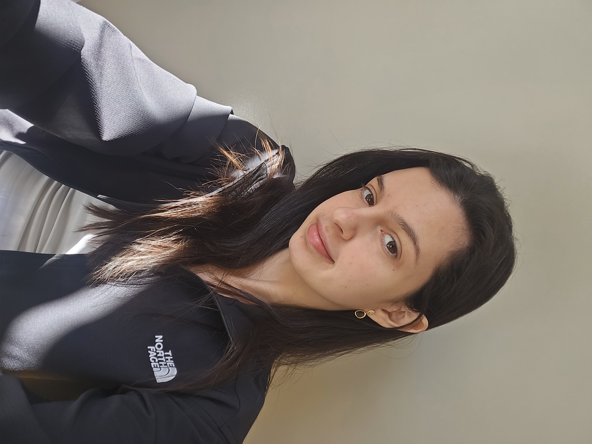

::: {.about-split}

::: {.about-split-left}
{.about-photo}

# Marina Fuzaro

Master in Mathematics, teacher, and researcher in History of Mathematical Education.

<a href="mailto:marinafuzaro@gmail.com" class="about-link"><svg class="nav-icon" aria-hidden="true"><use xlink:href="www/icons/email.svg#icon"></use></svg> Email</a><a href="http://lattes.cnpq.br/7681457601206658" class="about-link"> Lattes</a><a href="https://www.linkedin.com/in/marina-fuzaro-magossi-3babb8157/" class="about-link"><svg class="nav-icon" aria-hidden="true"><use xlink:href="www/icons/linkedin.svg#icon"></use></svg> LinkedIn</a>

:::

::: {.about-split-right}

## Education

<strong>PhD in Mathematics Education</strong> — UNESP, Rio Claro2027 – present

<strong>Professional Master's in Mathematics</strong> — UNESP, Rio Claro2023 – 2026

<ul class="edu-details">
<li>Thesis: <a href="https://repositorio.unesp.br/entities/publication/4f49a472-bc82-4ee1-9a16-e60a361b49d6"><em>Teoremas de Hahn-Banach e algumas aplicações</em></a></li>
<li>Advisor: Suzete Maria Silva Afonso</li>
</ul>

<strong>Degree in Pedagogy</strong> — UNIVESP2023 – present

<strong>B.Sc. and Teaching Degree in Mathematics</strong> — UNESP, Rio Claro2017 – 2021

## Experience

<strong>Mathematics Teacher</strong> — Colégio Metropolitano2024 – 2025

<strong>High School Mathematics Teacher</strong> — Fundação Municipal de Ensino de Piracicaba 2024

<strong>Mathematics Tutor</strong> — Centro Educacional Terras do Engenho2023 – 2024

<strong>Teaching Intern</strong> — Instituto de Geociências e Ciências Exatas (IGCE)2023

<ul class="edu-details">
<li>Calculus I (Ecology) & Calculus I for Ecologists</li>
</ul>

<strong>Teaching Assistant</strong> — Instituto de Geociências e Ciências Exatas (IGCE)2021

<ul class="edu-details">
<li>Linear Algebra I</li>
</ul>

:::

:::