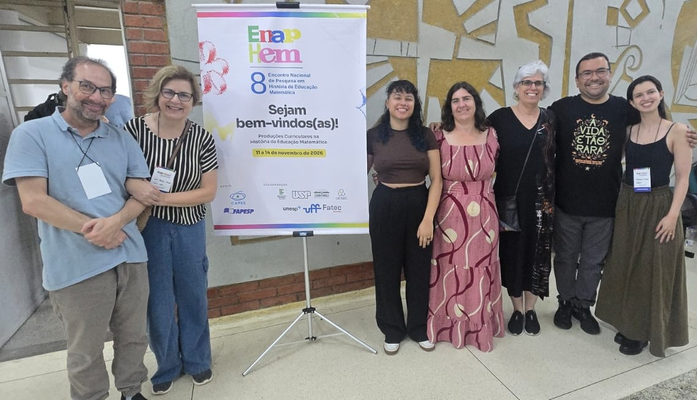
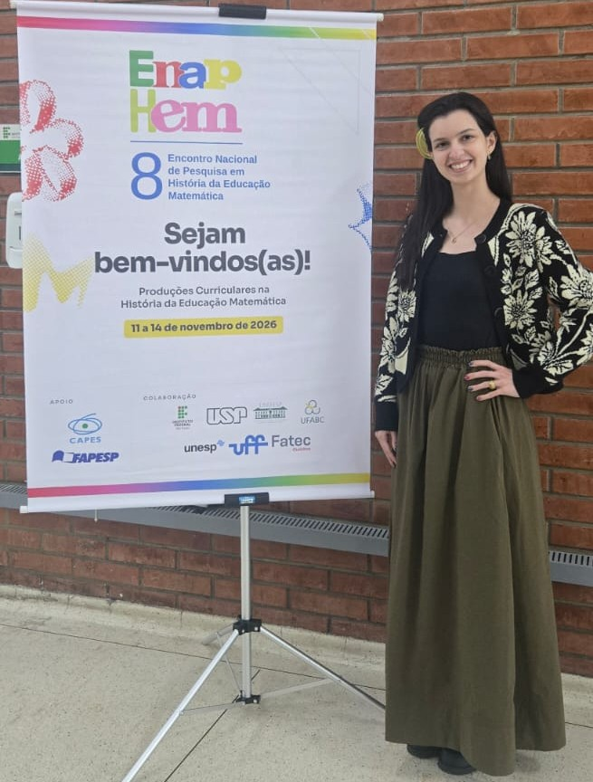

::: {.event-intro}

::: {.event-intro-text}
The **VIII ENAPHEM** — *Encontro Nacional de Pesquisa em História da Educação Matemática* — was held in São Paulo on 11–14 November 2026, under the theme *Produções Curriculares na História da Educação Matemática*. The meeting brings together the Brazilian research community in history of mathematics education.

<a href="https://www.even3.com.br/viiienapem-731910/" class="about-link" target="_blank" rel="noopener">Event website (Even3)</a>

{.event-group-photo fig-alt="Part of the GEPGE research group at the VIII ENAPHEM"}
:::

::: {.event-intro-photo}
{.event-photo fig-alt="Marina Fuzaro standing beside the VIII ENAPHEM welcome banner"}
:::

:::

## The work

I presented my doctoral project, *Validação em geometria nos anos finais do ensino secundário: estudo comparativo São Paulo e Espanha (1960–1979)*, developed at PPGEM/UNESP under the supervision of Profª Drª Maria Célia Leme da Silva, as part of GEPGE.

The project asks how processes of validation in school geometry took shape and changed at the end of secondary education in São Paulo and in Spain between 1960 and 1979, the years of the Modern Mathematics Movement. Validation is taken more broadly than formal demonstration: it covers the multiple ways of justifying, explaining and arguing geometric properties and concepts.

Textbooks from both settings will be analysed along five aspects (the basis of validation, how deductive reasoning is introduced, the forms of proof, the vocabulary of the sources, and the type and quantity of validation tasks) so that the differences between the two cases can be interpreted as distinct appropriations of one international movement.

## Slides

*The presentation is in Portuguese.* Scroll through the deck below, or [open it in a new tab](https://marinafuzaro.github.io/enaphem26-presentation/enaphem26-presentation.html){target="_blank"}.

<iframe src="https://marinafuzaro.github.io/enaphem26-presentation/enaphem26-presentation.html?view=scroll" title="VIII ENAPHEM — slides" loading="lazy" allowfullscreen></iframe>

Source for the slides: [marinafuzaro/enaphem26-presentation](https://github.com/marinafuzaro/enaphem26-presentation){target="_blank"}.
