## Gabarito

| Questão | Resposta | Assunto |
|---|---|---|
| [136](#questão-136) | D | Proporção (multiplicação e divisão) |
| [137](#questão-137) | C | Trigonometria (ângulos notáveis) |
| [138](#questão-138) | E | Escala (transformação km para cm) |
| [139](#questão-139) | C | Multiplicação, soma, comparação de números |
| [140](#questão-140) | A | Interpretação de texto, regra de 3, porcentagem |
| [141](#questão-141) | C | Proporção (multiplicação e divisão) |
| [142](#questão-142) | C | Leitura, propriedades de triângulos |
| [143](#questão-143) | B | Leitura, razão |
| [144](#questão-144) | D | Padrões e sequências |
| [145](#questão-145) | E | Média, moda e mediana |
| [146](#questão-146) | C | Volume, razão |
| [147](#questão-147) | B | Circunferências |
| [148](#questão-148) | E | Somar números |
| [149](#questão-149) | E | Probabilidade |
| [150](#questão-150) | A | Volume, conversão m³ → L |
| [151](#questão-151) | B | Porcentagem |
| [152](#questão-152) | E | Padrões |
| [153](#questão-153) | A | Análise de gráficos |
| [154](#questão-154) | B | Análise de gráficos, porcentagem |
| [155](#questão-155) | D | Porcentagem |
| [156](#questão-156) | D | Progressão geométrica |
| [157](#questão-157) | A | Análise combinatória, probabilidade |
| [158](#questão-158) | A | Probabilidade |
| [159](#questão-159) | D | Progressão geométrica |
| [160](#questão-160) | D | Função quadrática |
| [161](#questão-161) | A | Porcentagem |
| [162](#questão-162) | B | Leitura de gráficos |
| [163](#questão-163) | B | Logaritmo |
| [164](#questão-164) | B | Volume, geometria espacial |
| [165](#questão-165) | C | Média ponderada |
| [166](#questão-166) | C | Probabilidade |
| [167](#questão-167) | B | Funções (gráfico) |
| [168](#questão-168) | C | Padrões, contagem |
| [169](#questão-169) | C | Média |
| [170](#questão-170) | D | Juros compostos |
| [171](#questão-171) | D | Função afim |
| [172](#questão-172) | A | Geometria, trajetória |
| [173](#questão-173) | E | Razão, otimização |
| [174](#questão-174) | B | Geometria (setor circular) |
| [175](#questão-175) | D | Áreas |
| [176](#questão-176) | A | Gráficos, leitura de dados |
| [177](#questão-177) | ANULADA | Leitura de gráficos, porcentagem |
| [178](#questão-178) | E | Geometria, área |
| [179](#questão-179) | E | Orientação espacial |
| [180](#questão-180) | B | Sistemas lineares |

## Resoluções

### Questão 136

**Enunciado:**

> Alguns estudos comprovam que os carboidratos fornecem energia ao corpo, preservam as proteínas estruturais dos músculos durante a prática de atividade física e ainda dão força para o cérebro coordenar os movimentos, o que de fato tem impacto positivo no desenvolvimento do praticante. O ideal é consumir 1 grama de carboidrato para cada minuto de caminhada.
>
> CIRINO, C. *Boa pergunta: consumir carboidratos antes dos exercícios melhora o desempenho do atleta?* Revista Saúde! É Vital, n. 330, nov. 2010 (adaptado).
>
> Um casal realizará diariamente 30 minutos de caminhada, ingerindo, antes dessa atividade, a quantidade ideal de carboidratos recomendada. Para ter o consumo ideal apenas por meio do consumo de pão de fôrma integral, o casal planeja garantir o suprimento de pães para um período de 30 dias ininterruptos. Sabe-se que cada pacote desse pão vem com 18 fatias, e que cada uma delas tem 15 gramas de carboidratos.
>
> A quantidade mínima de pacotes de pão de fôrma necessários para prover o suprimento a esse casal é
>
> A) 1.\
> B) 4.\
> C) 6.\
> D) 7.\
> E) 8.

**Resolução:**
Como $1\text{g} / 1\text{min}$, então

$$30\text{ min/dia} \Rightarrow 30\text{g/dia} \Rightarrow 60\text{g para o casal}$$

Sabemos que 1 pacote tem 18 fatias, com 15g/fatia, e serão consumidas 4 fatias por dia (totalizando 60g/dia). Assim, o casal consome 4 fatias por dia, e em 30 dias, consumirá:

$$30 \times 4 = 120 \text{ fatias/mês}$$

$$\frac{120}{18} = \frac{60}{9} = \frac{20}{3} > 6 \quad \Rightarrow \quad \boxed{7 \text{ pacotes}}$$

**Resposta: D**

### Questão 137

**Enunciado:**

> O mastro de uma bandeira foi instalado perpendicularmente ao solo em uma região plana. Devido a fortes ventos, três cabos de aço, de mesmo comprimento, serão instalados para dar sustentação ao mastro. Cada cabo de aço ficará perfeitamente esticado, com uma extremidade num ponto *P* do mastro, a uma altura *h* do solo, e a outra extremidade, num ponto no chão, como mostra a figura.

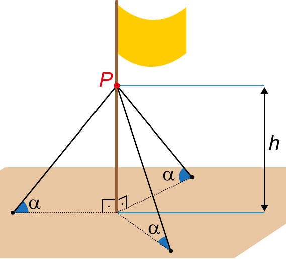{fig-alt="Mastro com bandeira e três cabos de aço formando ângulo α com o solo" width="30%" fig-align="center"}

> Os cabos de aço formam um ângulo α com o plano do chão.
>
> Por medida de segurança, há apenas três opções de instalação:
>
> - opção I: h = 11 m e α = 30°
> - opção II: h = 12 m e α = 45°
> - opção III: h = 18 m e α = 60°
>
> A opção a ser escolhida é aquela em que a medida dos cabos seja a menor possível.
>
> Qual será a medida, em metro, de cada um dos cabos a serem instalados?
>
> A) $\dfrac{22\sqrt{3}}{3}$\
> B) $11\sqrt{2}$\
> C) $12\sqrt{2}$\
> D) $12\sqrt{3}$\
> E) 22

**Resolução:**

$$\text{sen }\alpha = \dfrac{h}{\text{cabo}}$$

$$\text{sen } 30° = \frac{1}{2} = \frac{11}{\text{cabo}} \Rightarrow \text{cabo} = 22\text{m}$$

$$\text{sen } 45° = \frac{\sqrt{2}}{2} = \frac{12}{\text{cabo}} \Rightarrow \text{cabo} = 12\sqrt{2}\text{m}$$

$$\text{sen } 60° = \frac{\sqrt{3}}{2} = \frac{18}{\text{cabo}} \Rightarrow \text{cabo} = 12\sqrt{3}\text{m}$$

$$12\sqrt{2} \approx 17 \;<\; 12\sqrt{3} \approx 20 \;<\; 22$$

**Resposta: C**

### Questão 138

**Enunciado:**

> Um controlador de voo dispõe de um instrumento que descreve a altitude de uma aeronave em voo, em função da distância em solo. Essa distância em solo é a medida na horizontal entre o ponto de origem do voo até o ponto que representa a projeção ortogonal da posição da aeronave, em voo, no solo. Essas duas grandezas são dadas numa mesma unidade de medida.
>
> A tela do instrumento representa proporcionalmente as dimensões reais das distâncias associadas ao voo. A figura apresenta a tela do instrumento depois de concluída a viagem de um avião, sendo a medida do lado de cada quadradinho da malha igual a 1 cm.

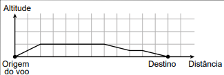{fig-alt="Gráfico de altitude por distância em malha quadriculada" width="50%" fig-align="center"}

> Essa tela apresenta os dados de um voo cuja maior altitude alcançada foi de 5 km.
>
> A escala em que essa tela representa as medidas reais é
>
> A) 1 : 5.\
> B) 1 : 11.\
> C) 1 : 55.\
> D) 1 : 5 000.\
> E) 1 : 500 000.

**Resolução:**

1 quadradinho = 1 cm

$$5\text{km} = 5\,000\text{m} = 500\,000\text{cm}$$

$$1 : 500\,000$$

**Resposta: E**

### Questão 139

**Enunciado:**

> Uma pessoa pratica quatro atividades físicas — caminhar, correr, andar de bicicleta e jogar futebol — como parte de seu programa de emagrecimento. Essas atividades são praticadas semanalmente de acordo com o quadro, que apresenta o número de horas diárias por atividade.

| Dias da semana | Caminhar | Correr | Andar de bicicleta | Jogar futebol |
|---|---|---|---|---|
| Segunda-feira | 1,0 | 0,5 | 0,0 | 2,0 |
| Terça-feira | 0,5 | 1,0 | 0,5 | 1,0 |
| Quarta-feira | 0,0 | 1,5 | 1,0 | 0,5 |
| Quinta-feira | 0,0 | 2,0 | 0,0 | 0,0 |
| Sexta-feira | 0,0 | 0,5 | 0,0 | 2,5 |

> Ela deseja comemorar seu aniversário e escolhe o dia da semana em que o gasto calórico com as atividades físicas praticadas for o maior. Para tanto, considera que os valores dos gastos calóricos das atividades por hora (cal/h) são os seguintes:

| Atividade física | Caminhar | Correr | Andar de bicicleta | Jogar futebol |
|---|---|---|---|---|
| Gasto calórico (cal/h) | 248 | 764 | 356 | 492 |

> O dia da semana em que será comemorado o aniversário é
>
> A) segunda-feira.\
> B) terça-feira.\
> C) quarta-feira.\
> D) quinta-feira.\
> E) sexta-feira.

**Resolução:**

Calculando o gasto calórico de cada dia:

$$\text{Segunda}: 1{,}0 \cdot 248 + 0{,}5 \cdot 764 + 2{,}0 \cdot 492 = 248 + 382 + 984 = 1614 \text{ cal}$$

$$\text{Terça}: 0{,}5 \cdot 248 + 1{,}0 \cdot 764 + 0{,}5 \cdot 356 + 1{,}0 \cdot 492 = 1558 \text{ cal}$$

$$\text{Quarta}: 1{,}5 \cdot 764 + 1{,}0 \cdot 356 + 0{,}5 \cdot 492 = 1146 + 356 + 246 = 1748 \text{ cal}$$

$$\text{Quinta}: 2{,}0 \cdot 764 = 1528 \text{ cal}$$

$$\text{Sexta}: 0{,}5 \cdot 764 + 2{,}5 \cdot 492 = 1612 \text{ cal}$$

O maior valor é o de quarta-feira (1748 cal).

**Resposta: C**

### Questão 140

**Enunciado:**

> A cada bimestre, a diretora de uma escola compra uma quantidade de folhas de papel ofício proporcional ao número de alunos matriculados. No bimestre passado, ela comprou 6 000 folhas para serem utilizadas pelos 1 200 alunos matriculados. Neste bimestre, alguns alunos cancelaram suas matrículas e a escola tem, agora, 1 150 alunos. A diretora só pode gastar R\$ 220,00 nessa compra, e sabe que o fornecedor da escola vende as folhas de papel ofício em embalagens de 100 unidades a R\$ 4,00 a embalagem. Assim, será preciso convencer o fornecedor a dar um desconto à escola, de modo que seja possível comprar a quantidade total de papel ofício necessária para o bimestre.
>
> O desconto necessário no preço final da compra, em porcentagem, pertence ao intervalo
>
> A) (5,0 ; 5,5).\
> B) (8,0 ; 8,5).\
> C) (11,5 ; 12,5).\
> D) (19,5 ; 20,5).\
> E) (3,5 ; 4,0).

**Resolução:**

Pela proporção, a quantidade de folhas necessária neste bimestre é

$$x = \frac{1150 \times 6000}{1200} = 5750 \text{ folhas}$$

Como cada embalagem tem 100 folhas por R\$ 4,00:

$$\frac{5750}{100} = 57{,}5 \approx 58 \text{ pacotes} \times \text{R\$}4 = \text{R\$}232$$

O desconto necessário, em reais, é $232 - 220 = 12$. Em porcentagem sobre R\$ 232:

$$\frac{12}{232} \approx 5{,}17\%$$

**Resposta: A**

### Questão 141

**Enunciado:**

> O calendário maia apresenta duas contagens simultâneas de anos, o chamado ano Tzolkim, composto por 260 dias e que determinava o calendário religioso, e o ano Haab, composto por 365 dias e que determinava o calendário agrícola. Um historiador encontrou evidências de que gerações de uma mesma família governaram certa comunidade maia pelo período de 20 ciclos, sendo cada ciclo formado por 52 anos Haab.
>
> *Disponível em: www.suapesquisa.com. Acesso em: 20 ago. 2014.*
>
> De acordo com as informações fornecidas, durante quantos anos Tzolkim aquela comunidade maia foi governada por tal família?
>
> A) 741\
> B) 1 040\
> C) 1 460\
> D) 2 100\
> E) 5 200

**Resolução:**

$$1 \text{ ciclo} = 52 \text{ anos Haab}$$

$$20 \text{ ciclos} = 52 \times 20 = 1040 \text{ anos Haab}$$

Convertendo para dias (1 ano Haab = 365 dias):

$$1040 \times 365 = 379\,600 \text{ dias}$$

Convertendo para anos Tzolkim (1 ano Tzolkim = 260 dias):

$$\frac{379\,600}{260} = 1460 \text{ anos Tzolkim}$$

**Resposta: C**

### Questão 142

**Enunciado:**

> Sejam *a*, *b* e *c* as medidas dos lados de um triângulo retângulo, tendo *a* como medida da hipotenusa. Esses valores *a*, *b* e *c* são, respectivamente, os diâmetros dos círculos $C_1$, $C_2$ e $C_3$, como apresentados na figura.

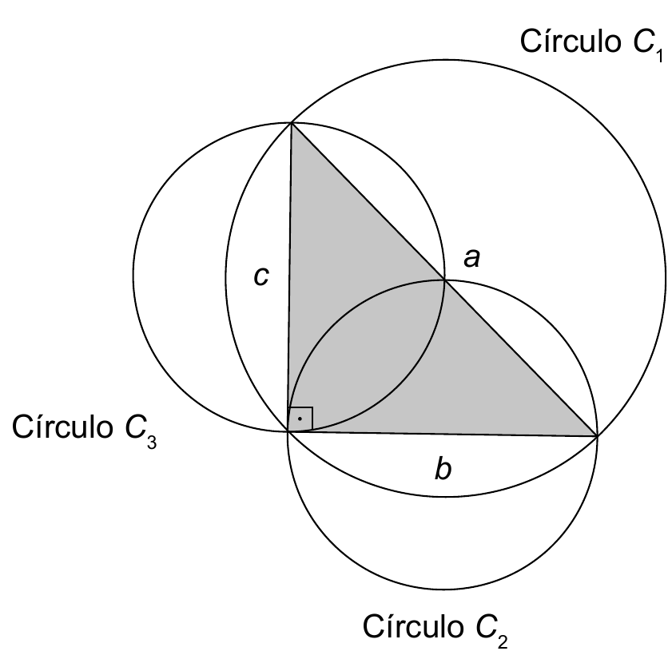{fig-alt="Triângulo retângulo com circunferências de diâmetros a, b e c" width="35%" fig-align="center"}

> Observe que essa construção assegura, pelo teorema de Pitágoras, que área($C_1$) = área($C_2$) + área($C_3$).
>
> Um professor de matemática era conhecedor dessa construção e, confraternizando com dois amigos em uma pizzaria onde são vendidas pizzas somente em formato de círculo, lançou um desafio: mesmo sem usar um instrumento de medição, poderia afirmar com certeza se a área do círculo correspondente à pizza que ele pedisse era maior, igual ou menor do que a soma das áreas das pizzas dos dois amigos. Assim, foram pedidas três pizzas. O professor as dividiu ao meio e formou um triângulo com os diâmetros das pizzas, conforme indicado na figura.

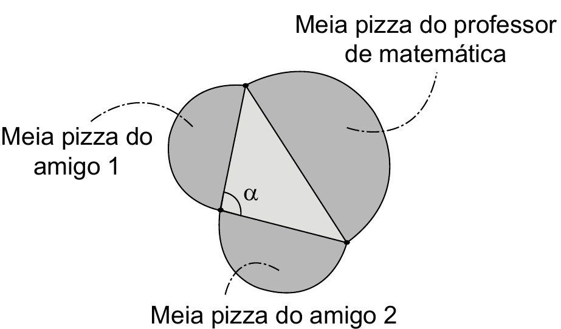{fig-alt="Representação das meias pizzas formando um triângulo com ângulo α" width="30%" fig-align="center"}

> A partir da medida do ângulo α, o professor afirmou que a área de sua pizza é maior do que a soma das áreas das outras duas pizzas.
>
> A área da pizza do professor de matemática é maior do que a soma das áreas das outras duas pizzas, pois
>
> A) 0° < α < 90°\
> B) α = 90°\
> C) 90° < α < 180°\
> D) α = 180°\
> E) 180° < α < 360°

**Resolução:**

Pela construção do triângulo retângulo, sabemos que, **se** o triângulo formado pelos raios das pizzas for retângulo (ângulo de 90°), então área($C_1$) = área($C_2$) + área($C_3$) — ou seja, as áreas seriam iguais.

Mas o professor afirma que a área da sua pizza é **maior** do que a soma das outras duas. Para que isso aconteça, o ângulo α formado precisa ser **maior** que 90° (um triângulo obtusângulo), já que quanto maior o ângulo oposto ao lado maior, maior esse lado (e, consequentemente, a área do círculo correspondente) precisa ser para "fechar" o triângulo.

Como α é um ângulo interno de um triângulo, não pode ultrapassar 180°.

**Resposta: C** (90° < α < 180°)

### Questão 143

**Enunciado:**

> Entre maratonistas, um parâmetro utilizado é o de economia de corrida (EC). O valor desse parâmetro é calculado pela razão entre o consumo de oxigênio, em mililitro (mL) por minuto (min), e a massa, em quilograma (kg), do atleta correndo a uma velocidade constante.
>
> *Disponível em: www.treinamentoonline.com.br. Acesso em: 23 out. 2019 (adaptado).*
>
> Um maratonista, visando melhorar sua performance, auxiliado por um médico, mensura o seu consumo de oxigênio por minuto a velocidade constante. Com base nesse consumo e na massa do atleta, o médico calcula o EC do atleta.
>
> A unidade de medida da grandeza descrita pelo parâmetro EC é
>
> A) $\dfrac{\text{min}}{\text{mL} \cdot \text{kg}}$\
> B) $\dfrac{\text{mL}}{\text{min} \cdot \text{kg}}$\
> C) $\dfrac{\text{min} \cdot \text{mL}}{\text{kg}}$\
> D) $\dfrac{\text{min} \cdot \text{kg}}{\text{mL}}$\
> E) $\dfrac{\text{mL} \cdot \text{kg}}{\text{min}}$

**Resolução:**

$$EC = \frac{\text{consumo de oxigênio}}{\text{massa}} = \frac{\text{mL}/\text{min}}{\text{kg}} = \frac{\text{mL}}{\text{min} \cdot \text{kg}}$$

**Resposta: B**

### Questão 144

**Enunciado:**

> O gerente de uma fábrica pretende comparar a evolução das vendas de dois produtos similares (I e II). Para isso, passou a verificar o número de unidades vendidas de cada um desses produtos em cada mês. Os resultados dessa verificação, para os meses de abril a junho, são apresentados na tabela.

| Produto | Vendas em abril (unidade) | Vendas em maio (unidade) | Vendas em junho (unidade) |
|---|---|---|---|
| I | 80 | 90 | 100 |
| II | 190 | 170 | 150 |

> O gerente estava decidido a cessar a produção do produto II no mês seguinte àquele em que as vendas do produto I superassem as do produto II.
>
> Suponha que a variação na quantidade de unidades vendidas dos produtos I e II se manteve, mês a mês, como no período representado na tabela.
>
> Em qual mês o produto II parou de ser produzido?
>
> A) Junho.\
> B) Julho.\
> C) Agosto.\
> D) Setembro.\
> E) Outubro.

**Resolução:**

O produto I aumenta 10 unidades por mês, e o produto II diminui 20 unidades por mês. Continuando a tabela:

| Mês | Produto I | Produto II |
|---|---|---|
| Junho | 100 | 150 |
| Julho | 110 | 130 |
| Agosto | 120 | 110 |
| Setembro | 130 | 90 |

Em agosto, o produto I (120) ainda não supera o produto II (110)... na verdade, em agosto o produto I já supera: $120 > 110$. Então o produto II para de ser produzido no mês **seguinte** a agosto, ou seja, em setembro.

**Resposta: D**

### Questão 145

**Enunciado:**

> Uma empresa de transporte faz regularmente um levantamento do número de viagens realizadas durante o dia por todos os 160 motoristas cadastrados em seu aplicativo. Em um certo dia, foi gerado um relatório, por meio de um gráfico de barras, no qual se relacionaram a quantidade de motoristas com a quantidade de viagens realizadas até aquele instante do dia.

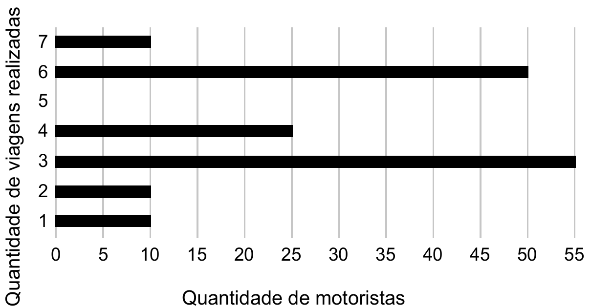{fig-alt="Gráfico de barras relacionando quantidade de motoristas com quantidade de viagens realizadas" width="60%" fig-align="center"}

> Comparando os valores da média, da mediana e da moda da distribuição das quantidades de viagens realizadas pelos motoristas cadastrados nessa empresa, obtém-se
>
> A) mediana = média < moda.\
> B) mediana = moda < média.\
> C) mediana < média < moda.\
> D) moda < média < mediana.\
> E) moda < mediana < média.

**Resolução:**

Do gráfico: 10 motoristas fizeram 1 viagem, 10 fizeram 2, 55 fizeram 3, 25 fizeram 4, 50 fizeram 6, e 10 fizeram 7 viagens (total: 160 motoristas).

**Moda** (valor mais frequente): 3 viagens (55 motoristas).

**Mediana** (posições 80 e 81, em ordem): somando as frequências acumuladas — 10, 20, 75, 100, 150, 160 — as posições 80 e 81 caem no grupo de 4 viagens. Mediana = 4.

**Média**:

$$\bar{x} = \frac{10(1) + 10(2) + 55(3) + 25(4) + 50(6) + 10(7)}{160} = \frac{10 + 20 + 165 + 100 + 300 + 70}{160} = \frac{665}{160} \approx 4{,}16$$

Logo, moda (3) < mediana (4) < média (4,16).

**Resposta: E**

### Questão 146

**Enunciado:**

> A foto mostra a construção de uma cisterna destinada ao armazenamento de água. Uma cisterna como essa, na forma de cilindro circular reto com 3 m² de área da base, foi abastecida por um curso-d'água com vazão constante. O seu proprietário registrou a altura do nível da água no interior da cisterna durante o abastecimento em diferentes momentos de um mesmo dia, conforme o quadro.

| Horário (h) | Nível da água (m) |
|---|---|
| 6:00 | 0,5 |
| 8:00 | 1,1 |
| 12:00 | 2,3 |
| 15:00 | 3,2 |

*(a questão também traz uma foto da construção da cisterna; disponível em: www.paraibamix.com. Acesso em: 3 dez. 2012.)*

> Qual foi a vazão, em metro cúbico por hora, do curso-d'água que abasteceu a cisterna?
>
> A) 0,3\
> B) 0,5\
> C) 0,9\
> D) 1,8\
> E) 2,7

**Resolução:**

Usando os dois primeiros horários (6:00 e 8:00), calculamos o volume da cisterna (área da base × altura):

$$V(6\text{h}) = 3 \times 0{,}5 = 1{,}5 \text{ m}^3$$

$$V(8\text{h}) = 3 \times 1{,}1 = 3{,}3 \text{ m}^3$$

A vazão é a variação de volume dividida pela variação de tempo:

$$\frac{3{,}3 - 1{,}5}{8 - 6} = \frac{1{,}8}{2} = 0{,}9 \text{ m}^3/\text{h}$$

**Resposta: C**

### Questão 147

**Enunciado:**

> Num certo momento de um jogo digital, a tela apresenta a imagem representada na figura. O ponto $Q_1$ representa a posição de um jogador que está com a bola, os pontos $Q_2$, $Q_3$, $Q_4$, $Q_5$ e $Q_6$ também indicam posições de jogadores da mesma equipe, e os pontos *A* e *B* indicam os dois pés da trave mais próxima deles. No momento da partida retratado, o jogador $Q_1$ tem a posse da bola, que será passada para um dos outros jogadores das posições $Q_n$, $n \in \{2, 3, 4, 5, 6\}$, cujo ângulo $\widehat{AQ_nB}$ tenha a mesma medida do ângulo $\alpha = \widehat{AQ_1B}$.

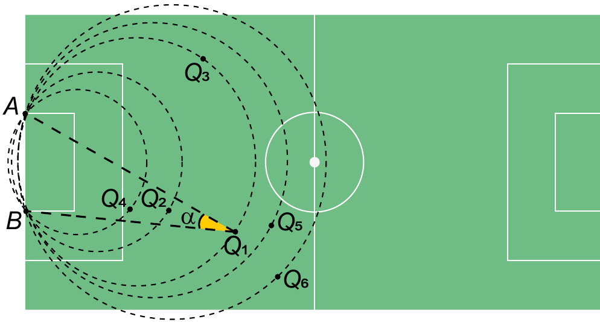{fig-alt="Campo de futebol com pontos Q1 a Q6 e arcos concêntricos" width="60%" fig-align="center"}

> Qual é o jogador que receberá a bola?
>
> A) $Q_2$\
> B) $Q_3$\
> C) $Q_4$\
> D) $Q_5$\
> E) $Q_6$

**Resolução:**

Pelo teorema do ângulo inscrito, pontos que enxergam um mesmo segmento (*AB*) sob o mesmo ângulo estão sobre um mesmo arco de circunferência passando por *A* e *B*. Observando a figura, $Q_1$ e $Q_3$ estão sobre o mesmo arco (a mesma circunferência pontilhada passa pelos dois pontos). Logo, $\widehat{AQ_3B} = \widehat{AQ_1B} = \alpha$.

**Resposta: B**

### Questão 148

**Enunciado:**

> O triângulo da figura é denominado triângulo mágico. Nos círculos, escrevem-se os números de 1 a 6, sem repetição, com um número em cada círculo. O objetivo é distribuir os números de forma que as somas dos números em cada lado do triângulo sejam iguais.

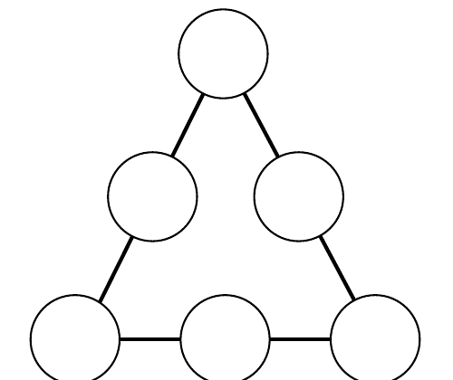{fig-alt="Triângulo com seis círculos vazios: três vértices e três pontos médios" width="25%" fig-align="center"}

> Considere que os números colocados nos vértices do triângulo estejam em progressão aritmética de razão igual a 2.
>
> Nas condições propostas, quais as possíveis soluções para as somas dos números que formam os lados do triângulo?
>
> A) Há somente uma solução possível, e as somas em cada lado do triângulo são iguais a 7.\
> B) Há somente uma solução possível, e as somas em cada lado do triângulo são iguais a 9.\
> C) Há somente duas soluções possíveis, uma em que as somas em cada lado do triângulo são iguais a 7 e outra em que as somas são iguais a 9.\
> D) Há somente duas soluções possíveis, uma em que as somas em cada lado do triângulo são iguais a 9 e outra em que as somas são iguais a 12.\
> E) Há somente duas soluções possíveis, uma em que as somas em cada lado do triângulo são iguais a 10 e outra em que as somas são iguais a 11.

**Resolução:**

Os vértices devem estar em PA de razão 2, usando números de 1 a 6 sem repetição. Testando as possibilidades, há duas configurações válidas:

- Vértices {1, 3, 5}: completando os lados com os números restantes {2, 4, 6}, obtemos somas iguais a **10** em cada lado.
- Vértices {2, 4, 6}: completando os lados com os números restantes {1, 3, 5}, obtemos somas iguais a **11** em cada lado.

**Resposta: E**

### Questão 149

**Enunciado:**

> No alojamento de uma universidade, há alguns quartos com o padrão superior ao dos demais. Um desses quartos ficou disponível, e muitos estudantes se candidataram para morar no local. Para escolher quem ficará com o quarto, um sorteio será realizado. Para esse sorteio, cartões individuais com os nomes de todos os estudantes inscritos serão depositados em uma urna, sendo que, para cada estudante de primeiro ano, será depositado um único cartão com seu nome; para cada estudante de segundo ano, dois cartões com seu nome; e, para cada estudante de terceiro ano, três cartões com seu nome. Foram inscritos 200 estudantes de primeiro ano, 150 de segundo ano e 100 de terceiro ano. Todos os cartões têm a mesma probabilidade de serem sorteados.
>
> Qual a probabilidade de o vencedor do sorteio ser um estudante de terceiro ano?
>
> A) $\dfrac{1}{2}$\
> B) $\dfrac{1}{3}$\
> C) $\dfrac{1}{8}$\
> D) $\dfrac{2}{9}$\
> E) $\dfrac{3}{8}$

**Resolução:**

Total de cartões na urna:

$$200(1) + 150(2) + 100(3) = 200 + 300 + 300 = 800 \text{ cartões}$$

Cartões de estudantes de terceiro ano: 300.

$$P = \frac{300}{800} = \frac{3}{8}$$

**Resposta: E**

### Questão 150

**Enunciado:**

> A água utilizada pelos 75 moradores de um vilarejo provém de um reservatório de formato cilíndrico circular reto cujo raio da base mede 5 metros, sempre abastecido no primeiro dia de cada mês por caminhões-pipa. Cada morador desse vilarejo consome, em média, 200 litros de água por dia.
>
> No mês de junho de um determinado ano, o vilarejo festejou o dia do seu padroeiro e houve um gasto extra de água nos primeiros 20 dias. Passado esse período, as pessoas verificaram a quantidade de água presente no reservatório e constataram que o nível da coluna de água estava em 1,5 metro. Decidiram, então, fazer um racionamento de água durante os 10 dias seguintes. Considere 3 como aproximação para π.
>
> Qual é a quantidade mínima de água, em litro, que cada morador, em média, deverá economizar por dia, de modo que o reservatório não fique sem água nos próximos 10 dias?
>
> A) 50\
> B) 60\
> C) 80\
> D) 140\
> E) 150

**Resolução:**

Volume de água no reservatório após os 20 dias (cilindro com raio 5m, altura 1,5m, usando π ≈ 3):

$$V = \pi r^2 h = 3 \times 5^2 \times 1{,}5 = 112{,}5 \text{ m}^3 = 112\,500 \text{ L}$$

Consumo normal esperado nos próximos 10 dias:

$$75 \text{ moradores} \times 200 \text{ L/dia} \times 10 \text{ dias} = 150\,000 \text{ L}$$

O déficit entre o que será consumido normalmente e o que está disponível:

$$150\,000 - 112\,500 = 37\,500 \text{ L (em 10 dias)}$$

Por dia, isso equivale a $37\,500 / 10 = 3\,750$ L de economia necessária. Dividindo entre os 75 moradores:

$$\frac{3\,750}{75} = 50 \text{ L por morador, por dia}$$

**Resposta: A**

### Questão 151

**Enunciado:**

> Em janeiro do ano passado, a direção de uma fábrica abriu uma creche para os filhos de seus funcionários, com 10 salas, cada uma com capacidade para atender 10 crianças a cada ano. As vagas são sorteadas entre os filhos dos funcionários inscritos, enquanto os não contemplados pelo sorteio formam uma lista de espera. No ano passado, a lista de espera teve 400 nomes, e neste ano, esse número cresceu 10%.
>
> A direção da fábrica realizou uma pesquisa e constatou que a lista de espera para o próximo ano terá a mesma quantidade de nomes da lista de espera deste ano. Decidiu, então, construir, ao longo deste ano, novas salas para a creche, também com capacidade de atendimento para 10 crianças cada, de modo que o número de nomes na lista de espera no próximo ano seja 25% menor que o deste ano.
>
> O número mínimo de salas que deverão ser construídas é
>
> A) 10.\
> B) 11.\
> C) 13.\
> D) 30.\
> E) 33.

**Resolução:**

Lista de espera deste ano (cresceu 10% em relação ao ano passado):

$$400 \times 1{,}10 = 440$$

Sem novas salas, a lista de espera no próximo ano se manteria em 440. Mas a meta é que, no próximo ano, a lista seja 25% menor que a deste ano:

$$440 \times 0{,}75 = 330$$

A diferença entre manter 440 e reduzir para 330 precisa ser absorvida pelas novas salas:

$$440 - 330 = 110 \text{ crianças}$$

Como cada sala atende 10 crianças por ano:

$$\frac{110}{10} = 11 \text{ salas}$$

**Resposta: B**

### Questão 152

**Enunciado:**

> Os números figurados pentagonais provavelmente foram introduzidos pelos pitagóricos por volta do século V a.C. As figuras ilustram como obter os seis primeiros deles, sendo os demais obtidos seguindo o mesmo padrão geométrico.

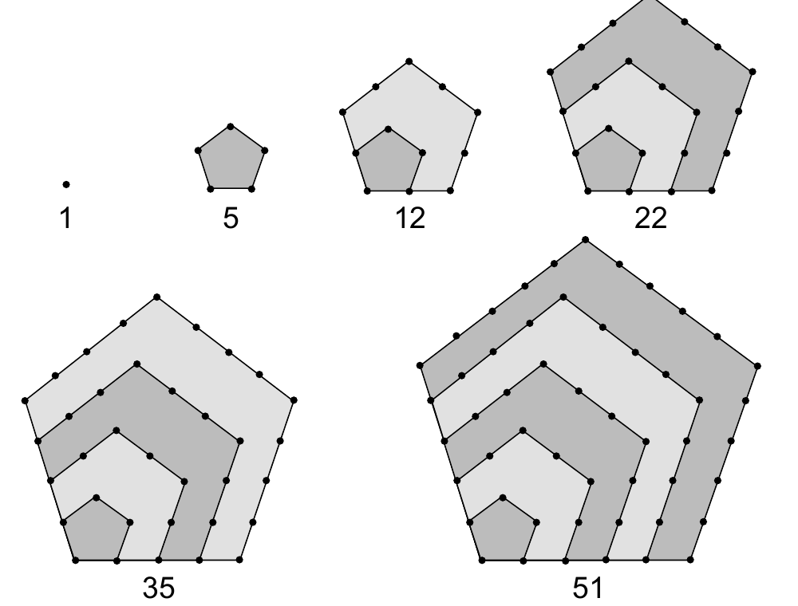{fig-alt="Seis pentágonos concêntricos ilustrando os números figurados pentagonais: 1, 5, 12, 22, 35, 51" width="55%" fig-align="center"}

> O oitavo número pentagonal é
>
> A) 59.\
> B) 83.\
> C) 86.\
> D) 89.\
> E) 92.

**Resolução:**

A sequência é 1, 5, 12, 22, 35, 51, ... Observando as diferenças entre termos consecutivos:

$$5-1=4,\quad 12-5=7,\quad 22-12=10,\quad 35-22=13,\quad 51-35=16$$

As diferenças aumentam de 3 em 3 (4, 7, 10, 13, 16, ...). Continuando o padrão:

$$\text{próxima diferença} = 16+3 = 19 \Rightarrow 7º\text{ termo} = 51+19 = 70$$

$$\text{próxima diferença} = 19+3 = 22 \Rightarrow 8º\text{ termo} = 70+22 = 92$$

**Resposta: E**

### Questão 153

**Enunciado:**

> A figura ilustra uma roda-gigante no exato instante em que a cadeira onde se encontra a pessoa *P* está no ponto mais alto dessa roda-gigante.

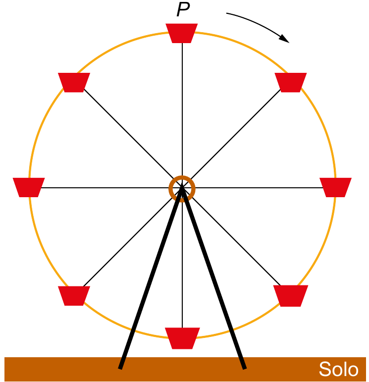{fig-alt="Roda-gigante com oito cadeiras, pessoa P no ponto mais alto" width="40%" fig-align="center"}

> Com o passar do tempo, à medida que a roda-gigante gira, com velocidade angular constante e no sentido horário, a altura da cadeira onde se encontra a pessoa *P*, em relação ao solo, vai se alterando.
>
> O gráfico que melhor representa a variação dessa altura, em função do tempo, contado a partir do instante em que a cadeira da pessoa *P* se encontra na posição mais alta da roda-gigante, é

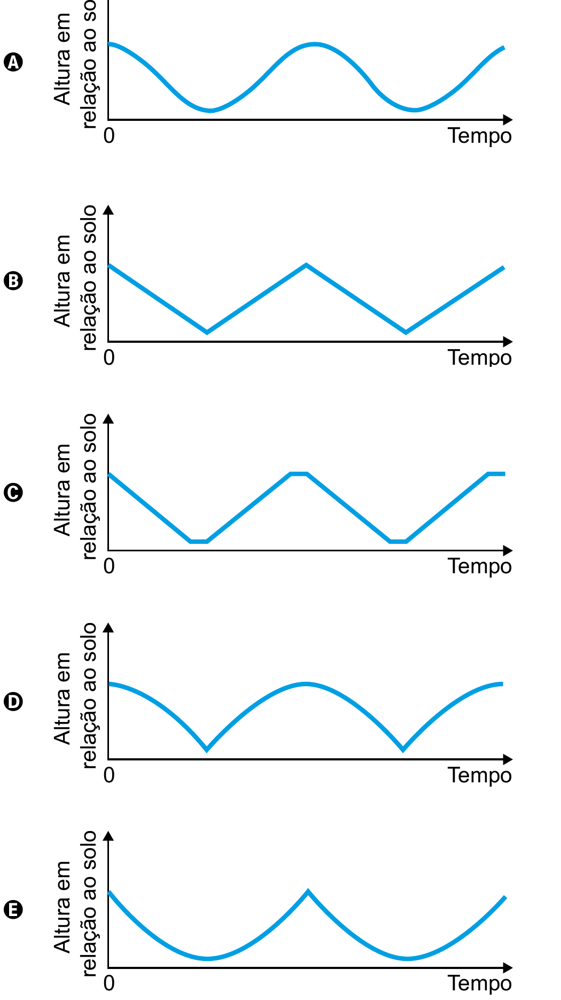{fig-alt="Cinco opções de gráfico altura por tempo, rotuladas A a E" width="45%" fig-align="center"}

**Resolução:**

Como a roda-gigante gira com velocidade angular **constante**, a altura da cadeira em relação ao solo varia de forma **suave e contínua** ao longo do tempo — um movimento circular uniforme, que corresponde a uma curva senoidal (sem "bicos" ou segmentos retos). Começando do ponto mais alto, a curva deve iniciar em um máximo e descer suavemente.

Apenas o gráfico A tem esse formato de onda suave e contínua, sem quinas.

**Resposta: A**

### Questão 154

**Enunciado:**

> Um professor, para promover a aprendizagem dos estudantes em estatística, propôs uma atividade. O objetivo era verificar o percentual de estudantes com massa corporal abaixo da média e altura acima da média de um grupo de estudantes. Para isso, usando uma balança e uma fita métrica, avaliou uma amostra de dez estudantes, anotando as medidas observadas. O gráfico apresenta a massa corporal, em quilograma, e a altura, em metro, obtidas na atividade.

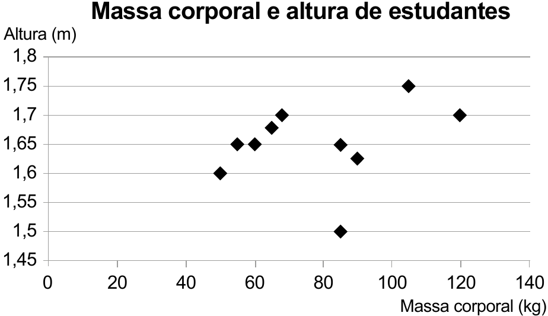{fig-alt="Gráfico de dispersão de massa corporal por altura de dez estudantes" width="55%" fig-align="center"}

> Após a coleta dos dados, os estudantes calcularam a média dos valores obtidos, referentes à massa corporal e à altura, obtendo, respectivamente, 80 kg e 1,65 m.
>
> Qual é o percentual de estudantes dessa amostra com massa corporal abaixo da média e altura acima da média?
>
> A) 10\
> B) 20\
> C) 30\
> D) 50\
> E) 70

**Resolução:**

Observando o gráfico, os pontos com massa corporal **abaixo** de 80 kg são: (50; 1,60), (55; 1,65), (60; 1,65), (65; 1,68) e (68; 1,70).

Dentre esses, os que têm altura **acima** de 1,65 m são apenas (65; 1,68) e (68; 1,70) — ou seja, 2 estudantes.

$$\frac{2}{10} = \frac{20}{100} = 20\%$$

**Resposta: B**

### Questão 155

**Enunciado:**

> Um pescador tem um custo fixo diário de R\$ 900,00 com combustível, iscas, manutenção de seu barco e outras pequenas despesas. Ele vende cada quilograma de peixe por R\$ 5,00. Sua meta é obter um lucro mínimo de R\$ 800,00 por dia. Sozinho, ele consegue, ao final de um dia de trabalho, pescar 180 kg de peixe, o que é suficiente apenas para cobrir o custo fixo diário. Portanto, precisa contratar ajudantes, pagando para cada um R\$ 250,00 por dia de trabalho. Além desse valor, 4% da receita obtida pela venda de peixe é repartida igualmente entre os ajudantes. Considerando o tamanho de seu barco, ele pode contratar até 5 ajudantes. Ele sabe que com um ajudante a pesca diária é de 300 kg e que, a partir do segundo ajudante contratado, aumenta-se em 100 kg a quantidade de peixe pescada por ajudante em um dia de trabalho.
>
> A quantidade mínima de ajudantes que esse pescador precisa contratar para conseguir o lucro diário pretendido é
>
> A) 1.\
> B) 2.\
> C) 3.\
> D) 4.\
> E) 5.

**Resolução:**

Com *n* ajudantes, a pesca total é $300 + (n-1) \times 100 = 200 + 100n$ kg. O lucro é a receita menos o custo fixo, o pagamento dos ajudantes e os 4% da receita repartidos entre eles:

$$\text{Lucro}(n) = -900 + 5(200+100n) - 250n - 0{,}04 \times 5(200+100n)$$

Calculando para cada *n*:

| *n* | kg pescados | Receita | Lucro |
|---|---|---|---|
| 1 | 300 | 1500 | $-900+1500-250-60 = 290$ |
| 2 | 400 | 2000 | $-900+2000-500-80 = 520$ |
| 3 | 500 | 2500 | $-900+2500-750-100 = 750$ |
| 4 | 600 | 3000 | $-900+3000-1000-120 = 980$ |

Com 4 ajudantes, o lucro (R\$ 980) já ultrapassa a meta de R\$ 800. Com 3, ainda não (R\$ 750).

**Resposta: D**

### Questão 156

**Enunciado:**

> Um agricultor é informado sobre um método de proteção para sua lavoura que consiste em inserir larvas específicas, de rápida reprodução. A reprodução dessas larvas faz com que sua população multiplique-se por 10 a cada 3 dias e, para evitar eventuais desequilíbrios, é possível cessar essa reprodução aplicando-se um produto X. O agricultor decide iniciar esse método com 100 larvas e dispõe de 5 litros do produto X, cuja aplicação recomendada é de exatamente 1 litro para cada população de 200 000 larvas. A quantidade total do produto X de que ele dispõe deverá ser aplicada de uma única vez.
>
> Quantos dias após iniciado esse método o agricultor deverá aplicar o produto X?
>
> A) 2\
> B) 4\
> C) 6\
> D) 12\
> E) 18

**Resolução:**

O produto X disponível (5 L) deve ser aplicado quando a população atingir:

$$5 \text{ L} \times 200\,000 \text{ larvas/L} = 1\,000\,000 \text{ larvas}$$

A população começa em 100 larvas e multiplica por 10 a cada 3 dias:

$$100 \to 1\,000 \to 10\,000 \to 100\,000 \to 1\,000\,000$$

Isso são 4 multiplicações por 10, ou seja, $4 \times 3 = 12$ dias.

**Resposta: D**

### Questão 157

**Enunciado:**

> Ao realizar o cadastro em um aplicativo de investimentos, foi solicitado ao usuário que criasse uma senha, sendo permitido o uso somente dos seguintes caracteres:
>
> - algarismos de 0 a 9;
> - 26 letras minúsculas do alfabeto;
> - 26 letras maiúsculas do alfabeto;
> - 6 caracteres especiais !, @, #, \$, \*, &.
>
> Três tipos de estruturas para senha foram apresentadas ao usuário:
>
> - tipo I: formada por quaisquer quatro caracteres distintos, escolhidos dentre os permitidos;
> - tipo II: formada por cinco caracteres distintos, iniciando por três letras, seguidas por um algarismo e, ao final, um caractere especial;
> - tipo III: formada por seis caracteres distintos, iniciando por duas letras, seguidas por dois algarismos e, ao final, dois caracteres especiais.
>
> Considere $p_1$, $p_2$ e $p_3$ as probabilidades de se descobrirem ao acaso, na primeira tentativa, as senhas dos tipos I, II e III, respectivamente.
>
> Nessas condições, o tipo de senha que apresenta a menor probabilidade de ser descoberta ao acaso, na primeira tentativa, é o
>
> A) tipo I, pois $p_1 < p_2 < p_3$.\
> B) tipo I, pois tem menor quantidade de caracteres.\
> C) tipo II, pois tem maior quantidade de letras.\
> D) tipo III, pois $p_3 < p_2 < p_1$.\
> E) tipo III, pois tem maior quantidade de caracteres.

**Resolução:**

Total de caracteres permitidos: $10+26+26+6=68$.

$$p_1 = \frac{1}{68 \times 67 \times 66 \times 65}$$

$$p_2 = \frac{1}{52 \times 51 \times 50 \times 10 \times 6}$$

$$p_3 = \frac{1}{52 \times 51 \times 10 \times 9 \times 6 \times 5}$$

Comparando os denominadores (quanto maior o denominador, menor a probabilidade), obtém-se $p_1 < p_2 < p_3$ — ou seja, a senha tipo I é a mais difícil de descobrir ao acaso.

**Resposta: A**

### Questão 158

**Enunciado:**

> Em um colégio público, a admissão no primeiro ano se dá por sorteio. Neste ano há 55 candidatos, cujas inscrições são numeradas de 01 a 55. O sorteio de cada número de inscrição será realizado em etapas, utilizando-se duas urnas. Da primeira urna será sorteada uma bola, dentre bolas numeradas de 0 a 9, que representará o algarismo das unidades do número de inscrição a ser sorteado e, em seguida, da segunda urna, será sorteada uma bola para representar o algarismo das dezenas desse número. Depois do primeiro sorteio, e antes de se sortear o algarismo das dezenas, as bolas que estarão presentes na segunda urna serão apenas aquelas cujos números formam, com o algarismo já sorteado, um número de 01 a 55.
>
> As probabilidades de os candidatos de inscrição número 50 e 02 serem sorteados são, respectivamente,
>
> A) $\dfrac{1}{50}$ e $\dfrac{1}{60}$\
> B) $\dfrac{1}{50}$ e $\dfrac{1}{50}$\
> C) $\dfrac{1}{50}$ e $\dfrac{1}{10}$\
> D) $\dfrac{1}{55}$ e $\dfrac{1}{54}$\
> E) $\dfrac{1}{100}$ e $\dfrac{1}{100}$

**Resolução:**

**Candidato 50** (unidade = 0, dezena = 5): na urna das unidades, probabilidade $1/10$. Sorteado o 0, a urna das dezenas só pode conter dígitos que formem um número de 01 a 55 com unidade 0, ou seja, dezenas 1, 2, 3, 4, 5 (5 possibilidades) — probabilidade $1/5$.

$$\frac{1}{10} \times \frac{1}{5} = \frac{1}{50}$$

**Candidato 02** (unidade = 2, dezena = 0): na urna das unidades, probabilidade $1/10$. Sorteado o 2, a urna das dezenas pode conter 0, 1, 2, 3, 4, 5 (6 possibilidades, já que X2 com dezena até 5 sempre forma número válido ≤55) — probabilidade $1/6$.

$$\frac{1}{10} \times \frac{1}{6} = \frac{1}{60}$$

**Resposta: A**

### Questão 159

**Enunciado:**

> O esquema mostra como a intensidade luminosa decresce com o aumento da profundidade em um rio, sendo $L_0$ a intensidade na sua superfície.

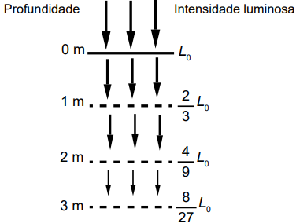{fig-alt="Esquema de profundidade x intensidade luminosa: 0m=L0, 1m=2/3 L0, 2m=4/9 L0, 3m=8/27 L0" width="35%" fig-align="center"}

> Considere que a intensidade luminosa diminui, a cada metro acrescido na profundidade, segundo o mesmo padrão do esquema.
>
> A intensidade luminosa correspondente à profundidade de 6 m é igual a
>
> A) $\frac{1}{9}L_0$\
> B) $\frac{16}{27}L_0$\
> C) $\frac{32}{243}L_0$\
> D) $\frac{64}{729}L_0$\
> E) $\frac{128}{2187}L_0$

**Resolução:**

A intensidade segue uma PG de razão $2/3$: $L_0, \frac{2}{3}L_0, \frac{4}{9}L_0, \frac{8}{27}L_0, \ldots$, ou seja, a profundidade $n$ corresponde a $\left(\frac{2}{3}\right)^n L_0$.

Para $n=6$:

$$\left(\frac{2}{3}\right)^6 = \frac{64}{729}$$

**Resposta: D**

### Questão 160

**Enunciado:**

> Analisando as vendas de uma empresa, o gerente concluiu que o montante diário arrecadado, em milhar de real, poderia ser calculado pela expressão $V(x) = \dfrac{x^2}{4} - 10x + 105$, em que os valores de $x$ representam os dias do mês, variando de 1 a 30.
>
> Um dos fatores para avaliar o desempenho mensal da empresa é verificar qual é o menor montante diário $V_0$ arrecadado ao longo do mês e classificar o desempenho conforme as categorias apresentadas a seguir, em que as quantidades estão expressas em milhar de real.
>
> - Ótimo: $V_0 \geq 24$
> - Bom: $20 \leq V_0 < 24$
> - Normal: $10 \leq V_0 < 20$
> - Ruim: $4 \leq V_0 < 10$
> - Péssimo: $V_0 < 4$
>
> No caso analisado, qual seria a classificação do desempenho da empresa?
>
> A) Ótimo.\
> B) Bom.\
> C) Normal.\
> D) Ruim.\
> E) Péssimo.

**Resolução:**

O menor valor de $V(x)$ ocorre no vértice da parábola. Com $a=1/4$, $b=-10$, $c=105$:

$$\Delta = b^2 - 4ac = 100 - 4 \cdot \frac{1}{4} \cdot 105 = 100 - 105 = -5$$

$$V_0 = y_v = \frac{-\Delta}{4a} = \frac{5}{4 \cdot \frac{1}{4}} = 5$$

Como $4 \leq 5 < 10$, a classificação é **Ruim**.

**Resposta: D**

**Resolução alternativa (sem usar a fórmula do vértice):**

Se não lembrar a fórmula $y_v = -\Delta/4a$, dá pra usar Bhaskara do mesmo jeito, mesmo com $\Delta$ negativo — não dá pra calcular a raiz quadrada de um número negativo, mas isso não impede de achar o $x_v$. Repare que o resultado da fórmula fica "$20$ mais ou menos alguma coisa":

$$x = \frac{10 \pm \sqrt{100 - 4 \cdot \frac{1}{4} \cdot 105}}{2 \cdot \frac{1}{4}} = \frac{10 \pm \sqrt{-5}}{\frac{1}{2}} = 20 \pm 2\sqrt{-5}$$

O $x_v$ fica exatamente no meio do "$20$ mais" e do "$20$ menos" — ou seja, somando as duas expressões e dividindo por 2, a parte do $\pm 2\sqrt{-5}$ se cancela e sobra só o 20:

$$x_v = \frac{(20+2\sqrt{-5})+(20-2\sqrt{-5})}{2} = \frac{40}{2} = 20$$

Substituindo de volta em $V(x)$:

$$V(20) = \frac{20^2}{4} - 10 \cdot 20 + 105 = 100 - 200 + 105 = 5$$

Mesmo resultado: $4 \leq 5 < 10 \Rightarrow$ **Ruim**.

### Questão 161

**Enunciado:**

> Dirigir após ingerir bebidas alcoólicas é uma atitude extremamente perigosa, uma vez que, a partir da primeira dose, a pessoa já começa a ter perda de sensibilidade de movimentos e de reflexos. Apesar de a eliminação e absorção do álcool depender de cada pessoa e de como o organismo consegue metabolizar a substância, ao final da primeira hora após a ingestão, a concentração de álcool (*C*) no sangue corresponde a aproximadamente 90% da quantidade (*q*) de álcool ingerida, e a eliminação total dessa concentração pode demorar até 12 horas.
>
> *Disponível em: http://g1.globo.com. Acesso em: 1 dez. 2018 (adaptado).*
>
> Nessas condições, ao final da primeira hora após a ingestão da quantidade *q* de álcool, a concentração *C* dessa substância no sangue é expressa algebricamente por
>
> A) $C = 0{,}9q$\
> B) $C = 0{,}1q$\
> C) $C = 1 - 0{,}1q$\
> D) $C = 1 - 0{,}9q$\
> E) $C = q - 10$

**Resolução:**

Como a concentração corresponde a 90% da quantidade ingerida:

$$C = \frac{90}{100} \cdot q = 0{,}9q$$

**Resposta: A**

### Questão 162

**Enunciado:**

> Um investidor iniciante observou o gráfico que apresenta a evolução dos valores de duas criptomoedas A e B em relação ao tempo.

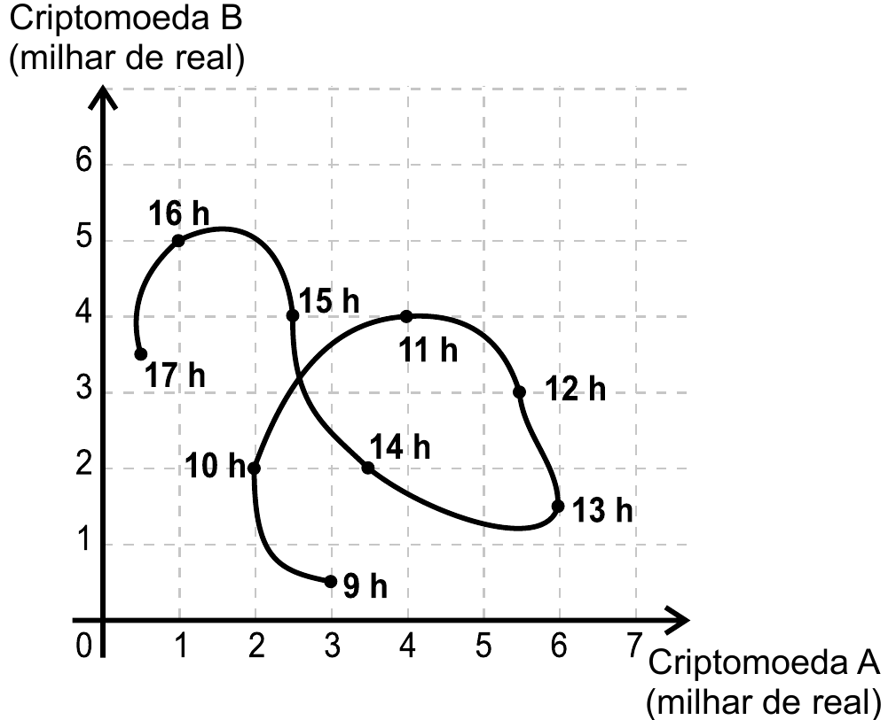{fig-alt="Gráfico da evolução de criptomoeda A versus criptomoeda B em 9 instantes" width="55%" fig-align="center"}

> Durante horas consecutivas, esses valores foram observados em nove instantes, representados por horas exatas.
>
> Em quantos desses instantes a criptomoeda A estava mais valorizada do que a criptomoeda B?
>
> A) 3\
> B) 4\
> C) 6\
> D) 7\
> E) 9

**Resolução:**

A criptomoeda A está mais valorizada que a B quando o ponto está **abaixo** da diagonal (onde A = B), ou seja, quando o valor no eixo A (horizontal) é maior que no eixo B (vertical).

Observando os 9 pontos marcados no gráfico (9h a 17h), os instantes em que isso ocorre são: 9h, 12h, 13h e 14h — totalizando 4 instantes.

**Resposta: B**

### Questão 163

**Enunciado:**

> A exposição a alguns níveis sonoros pode causar lesões auditivas. Por isso, em uma indústria, são adotadas medidas preventivas de acordo com a máquina que o funcionário opera e o nível *N* de intensidade do som, medido em decibel (dB), a que o operário é exposto, sendo $N = \log_{10}I^{10} - \log_{10}I_0^{10}$, *I* a intensidade do som e $I_0 = 10^{-12}$ W/m².
>
> *Disponível em: www.sofisica.com.br. Acesso em: 8 jul. 2015 (adaptado).*
>
> Quando o som é considerado baixo, ou seja, $N = 48$ dB ou menos, deve ser utilizada a medida preventiva I. No caso de o som ser moderado, quando *N* está no intervalo (48 dB, 55 dB), deve ser utilizada a medida preventiva II. Quando o som é moderado alto, que equivale a *N* no intervalo (55 dB, 80 dB), a medida preventiva a ser usada é a III. Se *N* estiver no intervalo (80 dB, 115 dB), quando o som é considerado alto, deve ser utilizada a medida preventiva IV. E se o som é considerado muito alto, com *N* maior que 115 dB, deve-se utilizar a medida preventiva V.
>
> Uma nova máquina, com $I = 8 \times 10^{-8}$ W/m², foi adquirida e será classificada de acordo com o nível de ruído que produz.
>
> Considere 0,3 como aproximação para $\log_{10}2$.
>
> O funcionário que operará a nova máquina deverá adotar a medida preventiva
>
> A) I.\
> B) II.\
> C) III.\
> D) IV.\
> E) V.

**Resolução:**

$$N = 10\log_{10}I - 10\log_{10}I_0 = 10\log_{10}(8 \times 10^{-8}) - 10\log_{10}(10^{-12})$$

$$= 10(\log_{10}2^3 - 8) + 120 = 10(3 \times 0{,}3 - 8) + 120 = 10(0{,}9-8)+120$$

$$= 9 - 80 + 120 = 49 \text{ dB}$$

Como $48 < 49 \leq 55$, a medida preventiva é a **II**.

**Resposta: B**

### Questão 164

**Enunciado:**

> Um artista plástico esculpe uma escultura a partir de um bloco de madeira de lei, em etapas. Inicialmente, esculpe um cone reto com 36 cm de altura e diâmetro da base medindo 18 cm. Em seguida, remove desse cone um cone menor, cujo diâmetro da base mede 6 cm, obtendo, assim, um tronco de cone, conforme ilustrado na figura.

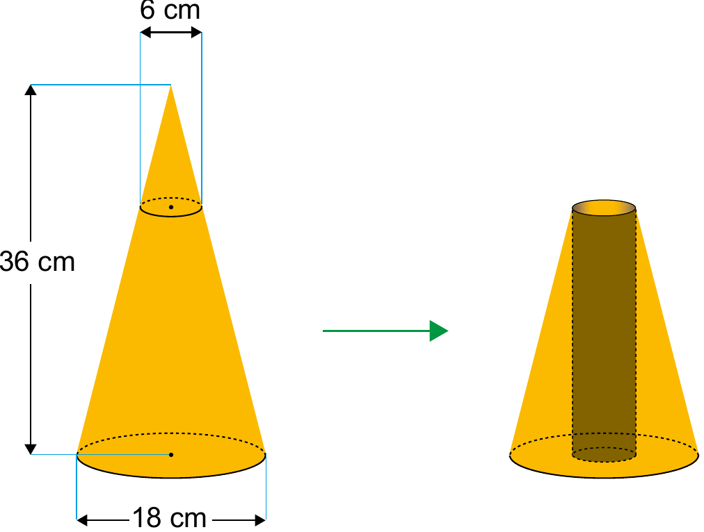{fig-alt="Cone de 36cm de altura e 18cm de diâmetro, com cone menor de 6cm removido, formando tronco de cone perfurado" width="40%" fig-align="center"}

> Em seguida, perfura esse tronco de cone, removendo um cilindro reto, de diâmetro 6 cm, cujo eixo de simetria é o mesmo do cone original. Dessa forma, ao final, a escultura tem a forma de um tronco de cone com uma perfuração cilíndrica de base a base.
>
> O tipo de madeira utilizada para produzir essa escultura tem massa igual a 0,6 g por centímetro cúbico de volume. Utilize 3 como aproximação para π.
>
> Qual é a massa, em grama, dessa escultura?
>
> A) 1 198,8\
> B) 1 296,0\
> C) 1 360,8\
> D) 4 665,6\
> E) 4 860,0

**Resolução:**

**Volume do cone grande** (raio 9, altura 36):

$$V_1 = \frac{\pi r^2 h}{3} = \frac{3 \times 9^2 \times 36}{3} = 2916 \text{ cm}^3$$

**Altura do cone pequeno removido** (raio 3): por semelhança de triângulos, $\dfrac{9}{3} = \dfrac{36}{x} \Rightarrow x = 12$ cm.

**Volume do cone pequeno** (raio 3, altura 12):

$$V_2 = \frac{3 \times 3^2 \times 12}{3} = 108 \text{ cm}^3$$

**Volume do cilindro perfurado** (raio 3, altura $36-12=24$):

$$V_3 = \pi r^2 h = 3 \times 3^2 \times 24 = 648 \text{ cm}^3$$

**Volume da escultura:**

$$V = V_1 - V_2 - V_3 = 2916 - 108 - 648 = 2160 \text{ cm}^3$$

**Massa:**

$$m = 2160 \times 0{,}6 = 1296 \text{ g}$$

**Resposta: B**

### Questão 165

**Enunciado:**

> Os 100 funcionários de uma empresa estão distribuídos em dois setores: Produção e Administração. Os funcionários de um mesmo setor recebem salários com valores iguais. O quadro apresenta a quantidade de funcionários por setor e seus respectivos salários.

| Setor | Quantidade de funcionários | Salário (em real) |
|---|---|---|
| Produção | 75 | 2 000,00 |
| Administração | 25 | 7 000,00 |

> A média dos salários dos 100 funcionários dessa empresa, em real, é
>
> A) 2 000,00.\
> B) 2 500,00.\
> C) 3 250,00.\
> D) 4 500,00.\
> E) 9 000,00.

**Resolução:**

$$\bar{x} = \frac{75 \times 2000 + 25 \times 7000}{75+25} = \frac{150\,000+175\,000}{100} = \frac{325\,000}{100} = 3250$$

**Resposta: C**

### Questão 166

**Enunciado:**

> Visando atrair mais clientes, o gerente de uma loja anunciou uma promoção em que cada cliente que realizar uma compra pode ganhar um voucher para ser usado em sua próxima compra. Para ganhar seu voucher, o cliente precisa retirar, ao acaso, uma bolinha de dentro de cada uma das duas urnas A e B disponibilizadas pelo gerente, nas quais há apenas bolinhas pretas e brancas. Atualmente, a probabilidade de se escolher, ao acaso, uma bolinha preta na urna A é igual a 20% e a probabilidade de se escolher uma bolinha preta na urna B é 25%. Ganha o voucher o cliente que retirar duas bolinhas pretas, uma de cada urna.
>
> Com o passar dos dias, o gerente percebeu que, para a promoção ser viável aos negócios, era preciso alterar a probabilidade de acerto do cliente sem alterar a regra da promoção. Para isso, resolveu alterar a quantidade de bolinhas brancas na urna B de forma que a probabilidade de um cliente ganhar o voucher passasse a ser menor ou igual a 1%. Sabe-se que a urna B tem 4 bolinhas pretas e que, em ambas as urnas, todas as bolinhas têm a mesma probabilidade de serem retiradas.
>
> Qual é o número mínimo de bolinhas brancas que o gerente deve adicionar à urna B?
>
> A) 20\
> B) 60\
> C) 64\
> D) 68\
> E) 80

**Resolução:**

Como a urna B tem 4 bolinhas pretas representando 25% do total, o total atual de bolinhas em B é:

$$4 = 0{,}25 \times \text{total} \Rightarrow \text{total} = 16$$

Queremos que, após adicionar *b* bolinhas brancas, a probabilidade de tirar bolinha preta de B (multiplicada pela probabilidade de 20% em A) seja no máximo 1%:

$$0{,}20 \times P_B \leq 0{,}01 \Rightarrow P_B \leq 0{,}05 = 5\%$$

A nova probabilidade de preta em B, com *b* bolinhas brancas adicionadas:

$$\frac{4}{16+b} \leq \frac{5}{100} \Rightarrow 400 \leq 5(16+b) \Rightarrow 400 \leq 80 + 5b \Rightarrow 320 \leq 5b \Rightarrow b \geq 64$$

**Resposta: C**

### Questão 167

**Enunciado:**

> Estudantes trabalhando com robótica criaram uma "torneira inteligente" que automatiza sua abertura e seu fechamento durante a limpeza das mãos. A tecnologia funciona da seguinte forma: ao se colocarem as mãos sob a torneira, ela libera água durante 3 segundos para que a pessoa possa molhá-las. Em seguida, interrompe o fornecimento de água por 5 segundos, enquanto a pessoa ensaboa suas mãos, e finaliza o ciclo liberando água para o enxágue por mais 3 segundos. Considere o tempo (*t*), em segundo, contado a partir do instante em que se inicia o ciclo. A vazão de água nessa torneira é constante.
>
> Um esboço de gráfico que descreve o volume de água acumulado, em litro, liberado por essa torneira durante um ciclo de lavagem das mãos, em função do tempo (*t*), em segundo, é

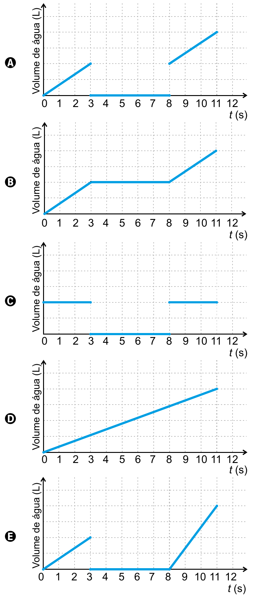{fig-alt="Cinco opções de gráfico volume de água por tempo, rotuladas A a E" width="45%" fig-align="center"}

**Resolução:**

O ciclo tem três fases:

- **0 a 3s:** água liberada → volume **sobe** (reta crescente)
- **3 a 8s:** água interrompida → volume **constante** (reta horizontal, sem subir nem descer)
- **8 a 11s:** água liberada de novo → volume **sobe** de novo

O gráfico precisa mostrar: subida (0-3s) → patamar constante (3-8s) → subida de novo (8-11s), sem voltar a zero em nenhum momento (a água acumulada não diminui). Esse é exatamente o formato do gráfico B.

**Resposta: B**

### Questão 168

**Enunciado:**

> As características culturais variam de povo para povo. Há notícias de um povo que possuía formas de contar diferentes das nossas, como indicado no quadrinho a seguir.

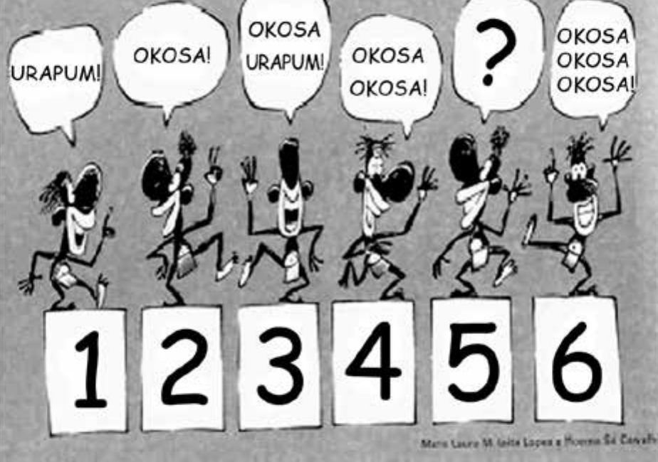{fig-alt="Seis personagens com balões de fala contando 'urapum' e 'okosa', numerados de 1 a 6" width="60%" fig-align="center"}

> Segundo o padrão de contagem indicado na figura, as representações dos numerais cinco e sete, nessa cultura, devem ser, respectivamente,
>
> A) okosa urapum urapum urapum e okosa okosa urapum urapum urapum.\
> B) okosa okosa urapum e okosa okosa okosa okosa urapum.\
> C) okosa okosa urapum e okosa okosa okosa urapum.\
> D) okosa urapum urapum e okosa urapum okosa urapum urapum.\
> E) okosa okosa urapum e okosa okosa okosa okosa.

**Resolução:**

Observando o padrão: 1 = urapum, 2 = okosa, 3 = okosa urapum, 4 = okosa okosa. Ou seja, "urapum" vale 1 e "okosa" vale 2, e a contagem soma esses valores.

Para o número **5**: $2+2+1 = 5 \Rightarrow$ okosa okosa urapum.

Para o número **7**: $2+2+2+1 = 7 \Rightarrow$ okosa okosa okosa urapum.

**Resposta: C**

### Questão 169

**Enunciado:**

> Um tipo de semente necessita de bastante água nos dois primeiros meses após o plantio. Um produtor pretende estabelecer o melhor momento para o plantio desse tipo de semente, nos meses de outubro a março. Após consultar a previsão do índice mensal de precipitação de chuva (ImPC) da região onde ocorrerá o plantio, para o período chuvoso de 2020-2021, ele obteve os seguintes dados:
>
> - outubro/2020: ImPC = 250 mm;
> - novembro/2020: ImPC = 150 mm;
> - dezembro/2020: ImPC = 200 mm;
> - janeiro/2021: ImPC = 450 mm;
> - fevereiro/2021: ImPC = 100 mm;
> - março/2021: ImPC = 200 mm.
>
> Com base nessas previsões, ele precisa escolher dois meses consecutivos em que a média mensal de precipitação seja a maior possível.
>
> No início de qual desses meses o produtor deverá plantar esse tipo de semente?
>
> A) Outubro.\
> B) Novembro.\
> C) Dezembro.\
> D) Janeiro.\
> E) Fevereiro.

**Resolução:**

Calculando a média de cada par de meses consecutivos:

- Out+Nov: $(250+150)/2 = 200$
- Nov+Dez: $(150+200)/2 = 175$
- Dez+Jan: $(200+450)/2 = 325$
- Jan+Fev: $(450+100)/2 = 275$
- Fev+Mar: $(100+200)/2 = 150$

A maior média é Dezembro+Janeiro (325 mm). Como a semente precisa de água nos dois primeiros meses, o plantio deve começar em **dezembro**.

**Resposta: C**

### Questão 170

**Enunciado:**

> Uma loja vende seus produtos de duas formas: à vista ou financiado em três parcelas mensais iguais. Para definir o valor dessas parcelas nas vendas financiadas, a loja aumenta em 20% o valor do produto à vista e divide esse novo valor por 3. A primeira parcela deve ser paga no ato da compra, e as duas últimas, em 30 e 60 dias após a compra.
>
> Um cliente da loja decidiu comprar, de forma financiada, um produto cujo valor à vista é R\$ 1 500,00.
>
> Utilize 5,29 como aproximação para $\sqrt{28}$.
>
> A taxa mensal de juros compostos praticada nesse financiamento é de
>
> A) 6,7%\
> B) 10%\
> C) 20%\
> D) 21,5%\
> E) 23,3%

**Resolução:**

Valor financiado: $1500 + 1500 \times 0{,}20 = 1500+300 = 1800$. Cada parcela: $1800/3 = 600$.

Como a primeira parcela é paga à vista (sem desconto de juros) e as demais em 30 e 60 dias, o valor à vista (R\$ 1500) deve ser igual à soma das parcelas trazidas a valor presente, com taxa mensal *x*:

$$600 + \frac{600}{1+x} + \frac{600}{(1+x)^2} = 1500$$

Multiplicando tudo por $(1+x)^2$:

$$600(1+x)^2 + 600(1+x) + 600 = 1500(1+x)^2$$

Expandindo:

$$600+1200x+600x^2+600+600x+600 = 1500+3000x+1500x^2$$

$$1800+1800x+600x^2 = 1500+3000x+1500x^2$$

$$900x^2+1200x-300=0 \;\Rightarrow\; 3x^2+4x-1=0$$

Por Bhaskara (*x* é uma taxa positiva):

$$x = \frac{-4+\sqrt{16+12}}{6} = \frac{-4+\sqrt{28}}{6} = \frac{-4+5{,}29}{6} = \frac{1{,}29}{6} \approx 0{,}215 = 21{,}5\%$$

**Resposta: D**

### Questão 171

**Enunciado:**

> Para concretar a laje de sua residência, uma pessoa contratou uma construtora. Tal empresa informa que o preço *y* do concreto bombeado é composto de duas partes: uma fixa, chamada de taxa de bombeamento, e uma variável, que depende do volume *x* de concreto utilizado. Sabe-se que a taxa de bombeamento custa R\$ 500,00 e que o metro cúbico do concreto bombeado é de R\$ 250,00.
>
> A expressão que representa o preço *y* em função do volume *x*, em metro cúbico, é
>
> A) $y = 250x$\
> B) $y = 500x$\
> C) $y = 750x$\
> D) $y = 250x + 500$\
> E) $y = 500x + 250$

**Resolução:**

O preço tem uma parte fixa (taxa de bombeamento, R\$ 500) e uma parte variável (R\$ 250 por metro cúbico, ou seja, $250x$):

$$y = 250x + 500$$

**Resposta: D**

### Questão 172

**Enunciado:**

> Uma empresa de segurança domiciliar oferece o serviço de patrulha noturna, no qual vigilantes em motocicletas fazem o monitoramento periódico de residências. A empresa conta com uma base, de onde acompanha o trajeto realizado pelos vigilantes durante as patrulhas e orienta o deslocamento de equipes de reforço quando necessário. Numa patrulha rotineira, sem ocorrências, um vigilante conduziu sua motocicleta a uma velocidade constante durante todo o itinerário estabelecido, levando 30 minutos para conclusão. De acordo com os registros do GPS alocado na motocicleta, a distância da posição do vigilante à base, ao longo do tempo de realização do trajeto, é descrita pelo gráfico.

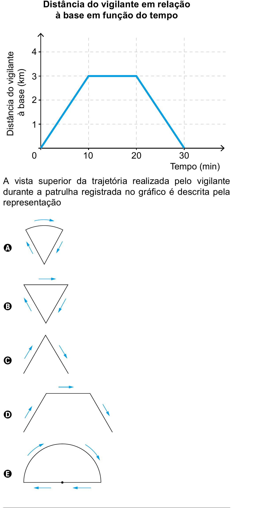{fig-alt="Gráfico de distância por tempo e cinco opções de trajetória vista de cima, rotuladas A a E" width="45%" fig-align="center"}

**Resolução:**

Pelo gráfico: a distância à base aumenta de 0 a 3 km (0 a 10 min), fica **constante em 3 km** (10 a 20 min), e depois diminui de volta a 0 (20 a 30 min).

Ficar à mesma distância da base por um tempo (10 a 20 min) significa que, nesse trecho, o vigilante percorreu um **arco de circunferência** centrado na base (já que todos os pontos de um arco estão à mesma distância do centro). Antes e depois desse arco, ele se afasta e se aproxima em linha reta (um "raio" da circunferência).

Esse formato — ida em linha reta, arco de círculo, volta em linha reta — corresponde a um **setor circular**, que é exatamente a forma da opção A.

**Resposta: A**

### Questão 173

**Enunciado:**

> Um supermercado conta com cinco caixas disponíveis para pagamento. Foram instaladas telas que apresentam o tempo médio gasto por cada caixa para iniciar e finalizar o atendimento de cada cliente, e o número de pessoas presentes na fila de cada caixa em tempo real. Um cliente, na hora de passar sua compra, sabendo que cada um dos cinco caixas iniciará um novo atendimento naquele momento, pretende gastar o menor tempo possível de espera na fila. Ele observa que as telas apresentavam as informações a seguir.
>
> - Caixa I: atendimento 12 minutos, 5 pessoas na fila.
> - Caixa II: atendimento 6 minutos, 9 pessoas na fila.
> - Caixa III: atendimento 5 minutos, 6 pessoas na fila.
> - Caixa IV: atendimento 15 minutos, 2 pessoas na fila.
> - Caixa V: atendimento 9 minutos, 3 pessoas na fila.
>
> Para alcançar seu objetivo, o cliente deverá escolher a caixa
>
> A) I.\
> B) II.\
> C) III.\
> D) IV.\
> E) V.

**Resolução:**

O tempo total de espera é o tempo de atendimento multiplicado pelo número de pessoas na fila (já que todos iniciam o atendimento no mesmo instante):

- Caixa I: $12 \times 5 = 60$ min
- Caixa II: $6 \times 9 = 54$ min
- Caixa III: $5 \times 6 = 30$ min
- Caixa IV: $15 \times 2 = 30$ min
- Caixa V: $9 \times 3 = 27$ min

O menor tempo é o da Caixa V (27 minutos).

**Resposta: E**

### Questão 174

**Enunciado:**

> As figuras pintadas no quadro da sala de estar de uma residência representam as silhuetas de parte das torres de um castelo e, ao fundo, a de uma lua cheia. A lua foi pintada na forma de um círculo, e o telhado da torre mais alta, na forma de triângulo equilátero, foi pintado sobrepondo parte da lua. O centro da lua coincide com um dos vértices do telhado da torre mais alta.

{fig-alt="Silhuetas de torres de castelo com uma lua (círculo) atrás da torre mais alta" width="40%" fig-align="center"}

> Nesse quadro, a parte da lua escondida atrás da torre mais alta do castelo pode ser representada por um
>
> A) cone.\
> B) setor circular.\
> C) segmento circular.\
> D) triângulo isósceles.\
> E) arco de circunferência.

**Resolução:**

O telhado é um triângulo equilátero com um vértice no centro da lua (círculo). A parte escondida da lua é a região do círculo "cortada" por um ângulo que parte do centro — e uma região circular delimitada por dois raios e um arco é, por definição, um **setor circular**.

**Resposta: B**

### Questão 175

**Enunciado:**

> Na planta baixa de um clube, a piscina é representada por um quadrado cuja área real mede 400 m². Ao redor dessa piscina, será construída uma calçada, de largura constante igual a 5 m.

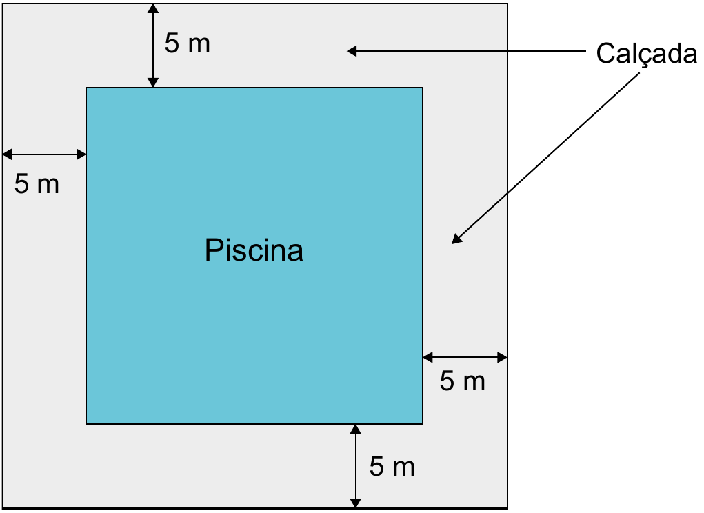{fig-alt="Planta baixa de piscina quadrada com calçada de 5 metros ao redor" width="45%" fig-align="center"}

> Qual é a medida da área, em metro quadrado, ocupada pela calçada?
>
> A) 1 000\
> B) 900\
> C) 600\
> D) 500\
> E) 400

**Resolução:**

O lado da piscina é $\sqrt{400} = 20$ m. Com a calçada de 5 m ao redor, o lado total (piscina + calçada dos dois lados) é:

$$20 + 5 + 5 = 30 \text{ m}$$

Área total: $30^2 = 900 \text{ m}^2$. Área da calçada:

$$900 - 400 = 500 \text{ m}^2$$

**Resposta: D**

### Questão 176

**Enunciado:**

> Uma pessoa caminha por 30 minutos e utiliza um aplicativo instalado em seu celular para monitorar a variação da intensidade do sinal de internet recebido pelo aparelho durante o deslocamento. Chegando ao seu destino, o aplicativo forneceu este gráfico:

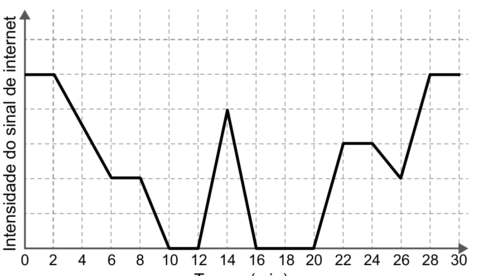{fig-alt="Gráfico de intensidade do sinal de internet por tempo, de 0 a 30 minutos" width="55%" fig-align="center"}

> Por quantos minutos, durante essa caminhada, o celular dessa pessoa ficou sem receber sinal de internet?
>
> A) 6\
> B) 8\
> C) 10\
> D) 14\
> E) 24

**Resolução:**

"Ficar sem sinal" corresponde aos trechos do gráfico em que a intensidade é igual a zero. Observando o gráfico, isso acontece em dois intervalos:

- **de 10 a 12 min:** $12-10 = 2$ minutos
- **de 16 a 20 min:** $20-16 = 4$ minutos

(O pico que aparece em $t=14$ min não conta, pois ali o sinal volta a subir acima de zero por um instante, interrompendo o período sem sinal.)

Somando os dois intervalos sem sinal:

$$2+4 = 6 \text{ minutos}$$

**Resposta: A**

### Questão 177

**Enunciado:**

> O gráfico expõe alguns números da gripe A-H1N1. Entre as categorias que estão em processo de imunização, uma já está completamente imunizada, a dos trabalhadores da saúde.

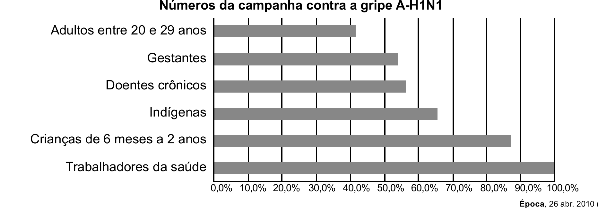{fig-alt="Gráfico de barras com o percentual de imunização contra a gripe A-H1N1 por categoria" width="65%" fig-align="center"}

> De acordo com o gráfico, entre as demais categorias, a que está mais exposta ao vírus da gripe A-H1N1 é a categoria de
>
> A) indígenas.\
> B) gestantes.\
> C) doentes crônicos.\
> D) adultos entre 20 e 29 anos.\
> E) crianças de 6 meses a 2 anos.

**Questão anulada. Por quê?**

Aparentemente, a resposta esperada seria a alternativa D. Porém, um grupo estar mais "exposto" não significa mais suscetível a contrair a doença e, sim, estar em maior contato com o vírus. Por isso, a resposta correta não consta nas alternativas: seria "trabalhadores da saúde" — categoria que, no enunciado, é justamente a excluída das opções por já estar completamente imunizada.

**Resposta: ANULADA**

### Questão 178

**Enunciado:**

> A figura representa uma escada com três degraus, construída em concreto maciço, com suas medidas especificadas.

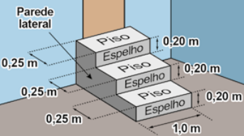{fig-alt="Escada de três degraus em concreto, com medidas de piso, espelho e parede lateral indicadas" width="45%" fig-align="center"}

> Nessa escada, pisos e espelhos têm formato retangular, e as paredes laterais têm formato de um polígono cujos lados adjacentes são perpendiculares. Pisos, espelhos e paredes laterais serão revestidos em cerâmica.
>
> A área a ser revestida em cerâmica, em metro quadrado, mede
>
> A) 1,20.\
> B) 1,35.\
> C) 1,65.\
> D) 1,80.\
> E) 1,95.

**Resolução:**

A escada tem 1,0 m de largura. Cada degrau tem piso de 0,25 m de profundidade e espelho de 0,20 m de altura.

**Área dos pisos** (3 degraus, cada um 0,25 m × 1,0 m):

$$3 \times (0{,}25 \times 1) = 0{,}75 \text{ m}^2$$

**Área dos espelhos** (3 degraus, cada um 0,20 m × 1,0 m):

$$3 \times (0{,}20 \times 1) = 0{,}60 \text{ m}^2$$

**Área das paredes laterais** (são duas, uma de cada lado): cada parede lateral tem o formato em "escada", que pode ser dividido em três retângulos horizontais empilhados — um para cada espelho, cada um com altura 0,20 m e profundidade igual à distância daquele espelho até a parede do fundo (0,75 m, 0,50 m e 0,25 m, de baixo para cima). Assim, a área de **uma** parede lateral é:

$$0{,}20 \times (0{,}75+0{,}50+0{,}25) = 0{,}20 \times 1{,}50 = 0{,}30 \text{ m}^2$$

Como são duas paredes laterais:

$$2 \times 0{,}30 = 0{,}60 \text{ m}^2$$

**Somando tudo** (pisos + espelhos + paredes laterais):

$$0{,}75+0{,}60+0{,}60 = 1{,}95 \text{ m}^2$$

**Resposta: E**

### Questão 179

**Enunciado:**

> Uma pessoa comprou um ingresso para o cinema em cuja entrada está afixado um mapa com a representação bidimensional do posicionamento das poltronas, conforme a figura. Essa pessoa, após consultar o mapa, começou a subir uma das escadas e parou na posição indicada pela estrela, direcionada para o norte. Ela conferiu seu bilhete e observou que, para encontrar sua poltrona, deveria partir do ponto onde estava, continuar subindo a escada na direção norte por mais quatro fileiras e olhar à sua direita, e sua poltrona será a terceira.

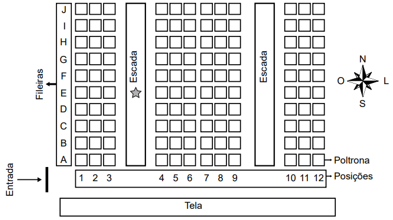{fig-alt="Mapa bidimensional de poltronas de cinema, com fileiras de A a J, escadas e rosa dos ventos" width="60%" fig-align="center"}

> Nesse cinema, as poltronas são identificadas por uma letra, que indica a fileira, e um número, que fornece a posição da poltrona na fileira, respectivamente.
>
> A poltrona dessa pessoa é a identificada por
>
> A) A6.\
> B) H1.\
> C) H6.\
> D) I1.\
> E) I6.

**Resolução:**

A estrela está na fileira **E**. Subindo mais 4 fileiras na direção norte (E → F → G → H → I), a pessoa chega à fileira **I**.

Olhando o mapa, o norte aponta para cima — então "olhar à direita" estando de frente para o norte significa olhar para o **leste**, ou seja, para dentro do bloco central de poltronas (em direção às posições mais altas, 4 a 9).

A partir da escada onde ela está (entre os blocos 1-3 e 4-9), a 3ª poltrona contando para a direita, dentro do bloco central, é a poltrona de número **6** (posições 4, 5, **6**).

Logo, a poltrona é **I6**.

**Resposta: E**

### Questão 180

**Enunciado:**

> O metrô de um município oferece dois tipos de tíquetes com colorações diferentes, azul e vermelha, sendo vendidos em cartelas, cada qual com nove tíquetes da mesma cor e mesmo valor unitário. Duas cartelas de tíquetes azuis e uma cartela de tíquetes vermelhos são vendidas por R\$ 32,40. Sabe-se que o preço de um tíquete azul menos o preço de um tíquete vermelho é igual ao preço de um tíquete vermelho mais cinco centavos.
>
> Qual o preço, em real, de uma cartela de tíquetes vermelhos?
>
> A) 4,68\
> B) 6,30\
> C) 9,30\
> D) 10,50\
> E) 10,65

**Resolução:**

Sejam *a* o preço de um tíquete azul e *v* o preço de um tíquete vermelho. Cada cartela tem 9 tíquetes.

**Primeira condição** (2 cartelas azuis + 1 cartela vermelha = R\$ 32,40):

$$2(9a) + 1(9v) = 32{,}40 \;\Rightarrow\; 18a+9v = 32{,}40$$

**Segunda condição** (azul menos vermelho é igual a vermelho mais 5 centavos):

$$a - v = v + 0{,}05 \;\Rightarrow\; a - 2v = 0{,}05$$

Multiplicando a segunda equação por 18:

$$18a - 36v = 0{,}90$$

Subtraindo essa equação da primeira:

$$(18a+9v) - (18a-36v) = 32{,}40-0{,}90$$

$$45v = 31{,}50 \;\Rightarrow\; v = 0{,}70$$

O preço de uma cartela de tíquetes vermelhos (9 tíquetes) é:

$$9 \times 0{,}70 = 6{,}30$$

**Resposta: B**
